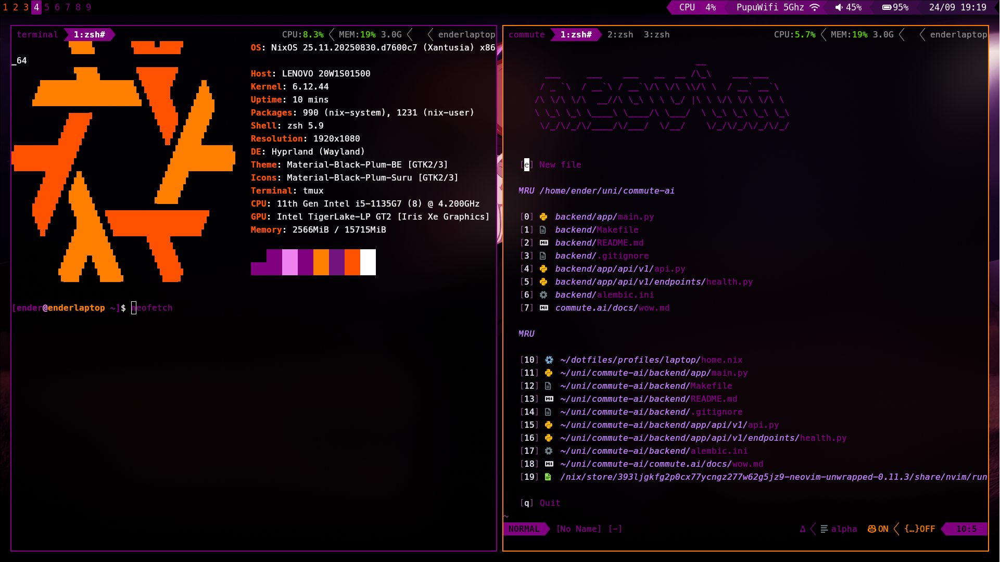

# my dotfiles

NixOS and Home Manager dotfiles in one flake.

## what's here

- wm: hyprland + kanshi (bean), aerospace (graff)
- shell/bar/launcher: noctalia (bar, launcher, clipboard, notifications, lockscreen, idle, wallpaper, greeter on bean)
- editor: neovim (nixvim)
- terminal: kitty + tmux + zsh (starship)
- browser: brave (bean)
- file manager: thunar (bean), finder (graff)
- theme: custom "pain" palette (purple and orange on black)

## setup

```bash
git clone https://github.com/3nd3r1/.dotfiles ~/dotfiles
cd ~/dotfiles

# personal laptop (NixOS + Home Manager)
make bean

# work mac (Home Manager)
make graff
```

Other make targets: `make update`, `make format`, `make lint`.

## profiles

- `bean`: personal laptop, NixOS + Home Manager (`x86_64-linux`)
- `graff`: work mac, Home Manager only (`aarch64-darwin`, tracked `profiles/graff/Brewfile`)

## machine names

Machines are named after Ender's Game:

- `bean`: laptop
- `graff`: work mac
- `dragon`: desktop
- `jane`: phone

## theme

Everything uses the "pain" colorscheme from `themes/pain.nix`:

- purple (`#800080`)
- orange (`#ff8000`)
- black backgrounds (`#000000`)
- Stylix plus custom noctalia, tmux and neovim themes


