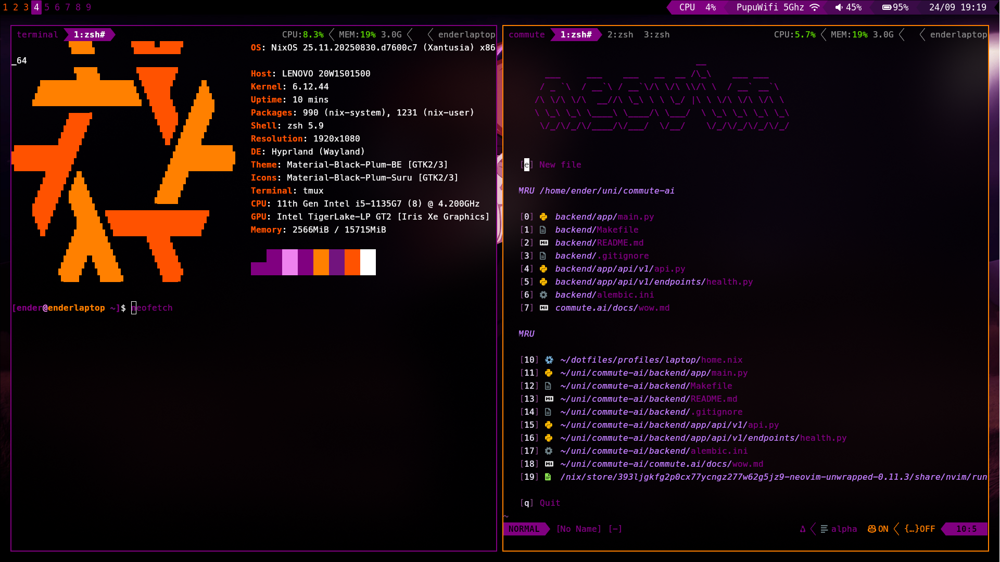

# my dotfiles

This repo is the home for my dotfiles. I manage them with Nix.

## what's here

- **WM**: hyprland + waybar (laptop), aerospace (work)
- **Editor**: neovim (nixvim config)  
- **Terminal**: kitty + tmux + zsh (oh-my-zsh)
- **Theme**: custom "pain" theme (purple/orange vibes)
- **File manager**: thunar (laptop), finder (work)
- **Launcher**: rofi (laptop)

## setup

```bash
# clone wherever
git clone https://github.com/3nd3r1/.dotfiles ~/dotfiles
cd ~/dotfiles

# laptop setup
make bean

# work setup  
make graff

# dev server setup
make devenv
```

`make` deploys with nh, which isn't installed on a fresh machine. Do the first switch without it:

```bash
sudo nixos-rebuild switch --flake .#bean                 # bean only
nix run nixpkgs#nh -- home switch . -c graff -b backup   # or -c bean / -c devenv
```

## profiles

- `bean` - personal laptop
- `graff` - work mac, home manager only
- `devenv` - dev server, home manager only, shell and neovim

## machine names

machines are named after ender's game:

- `bean` - laptop
- `graff` - work mac
- `dragon` - desktop

profiles use the same names. graff keeps its it-assigned hostname `vranta179-mac`, only the profile is renamed. devenv keeps its old name and hostname. the desktop is still `ENDER-PC`. new machines get a new name from the book. never use `ender`, that's the username.

## theme

everything uses the "pain" colorscheme:
- purple (#800080) 
- orange (#ff8000)
- black backgrounds
- custom tmux/waybar/rofi themes


